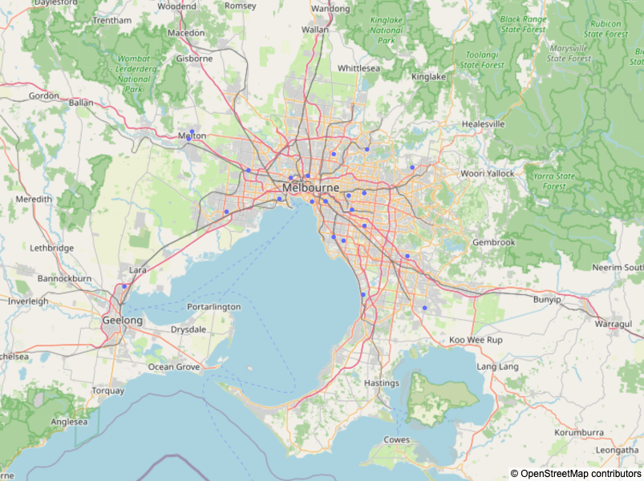

# Project A: victoria-rugby-fans

## Question
Where in Melbourne and Victoria's major regional cities (Geelong, Ballarat and Bendigo) do people born in Rugby World Cup 2027 countries live?

## Small Questions to help answering the Question above
- How can we identify potential rugby fans?
- Do those areas have AFL or football (soccer) clubs instead?

## Why this matters
In 2025, my university rugby club in Melbourne couldn’t field a Colts (under-21) team. In 2026, only four teams entered the Colts competition, while some clubs in NSW and Queensland have two Colts teams. This made me wonder why rugby in Victoria is at such a disadvantage compared with other states.

This project doesn’t aim to recruit more players. It aims to find where people who are likely to follow rugby live in Victoria, and whether there is a club near them. It is also the baseline for my next project on the 2027 Rugby World Cup.

I think a bigger fan base is the first step for the game to grow in Victoria. More fans can mean more players registering with clubs, more money coming into the competition, and better facilities, which lifts the quality of the game overall.

## Data

**Country of birth (2021 Census, General Community Profile, SA2, Victoria).**
Source: Australian Bureau of Statistics, Census DataPacks (tables G09F, G09G, G09H).

**Area names.**
Source: ABS 2021 Census geography descriptions (`2021Census_geog_desc_1st_2nd_3rd_release.xlsx`, in the DataPack's Metadata folder), used to add SA2 names.

**How "rugby-playing countries" were chosen.**
I counted people born in eight countries where rugby union is a major sport: New Zealand, Samoa, Fiji, South Africa, England, Scotland, Wales and Ireland. All eight played at the 2023 Rugby World Cup and have qualified for the 2027 Rugby World Cup in Australia.
I fixed this list before looking at any results, so that the countries were not picked to fit the outcome.

**Limits.**
- Country of birth is only a rough sign of who might follow rugby. It misses Australian-born fans and the children of migrants.
- Tonga is not reported separately in this dataset, so it is not included, although it also played at the 2023 Rugby World Cup and has qualified for 2027.
- Census figures are from 2021.
- The ABS slightly adjusts small counts to protect privacy, so my totals differ a little from ABS QuickStats (within 0.1% for Victoria).

**Rugby club locations (union only).**
Club list from Rugby Victoria's 2026 competition pages (men's, women's, colts and juniors). Home grounds and coordinates (latitude and longitude) from Google Maps, entered by hand. 26 clubs are used in the analysis. Date checked: 20 November 2026.
File: [data/rugby_clubs_vic.csv](data/rugby_clubs_vic.csv)

## Method (A01)
1. Added up people born in the eight countries for each SA2 area in Victoria.
2. Removed 14 areas with fewer than 1,000 residents.
3. Calculated the share of residents born in these countries, and ranked the remaining 510 areas.

## Results so far
- In the top 10 areas, 11–14% of residents were born in one of the eight countries, about 2–2.5 times the Victorian average (5.74%).
- The top areas are on the Mornington Peninsula and around Frankston, in Bayside and in St Kilda.
- England-born residents are the largest group in 9 of the 10 areas. Point Cook - East is the exception, with more New Zealand-born residents.
- These areas look like places where rugby may already have a base. Most potential new fans are likely to be Australian-born.

Notebook: [notebooks/a01-data-collection.ipynb](notebooks/a01-data-collection.ipynb)
Results table (510 areas): [data/a01_rugby_born_by_sa2.csv](data/a01_rugby_born_by_sa2.csv)

### Club map (A02, first step)

- Most clubs are in inner and middle Melbourne. There are fewer in the north and the west.
- There is no club on the Mornington Peninsula, where four of the top 10 areas are. Distances will be checked next.

Notebook: [notebooks/a02-clubs-near-areas.ipynb](notebooks/a02-clubs-near-areas.ipynb)

## Status
- A01 (census data, top 10 areas): done
- Rugby club table (26 clubs with locations): done
- A02 (clubs near the top 10 areas): in progress (club map done; distances next)
- A03 (simplified question, World Cup countries): in progress
